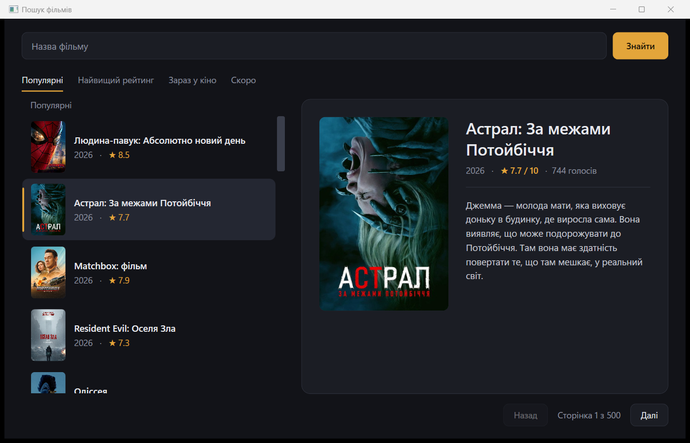
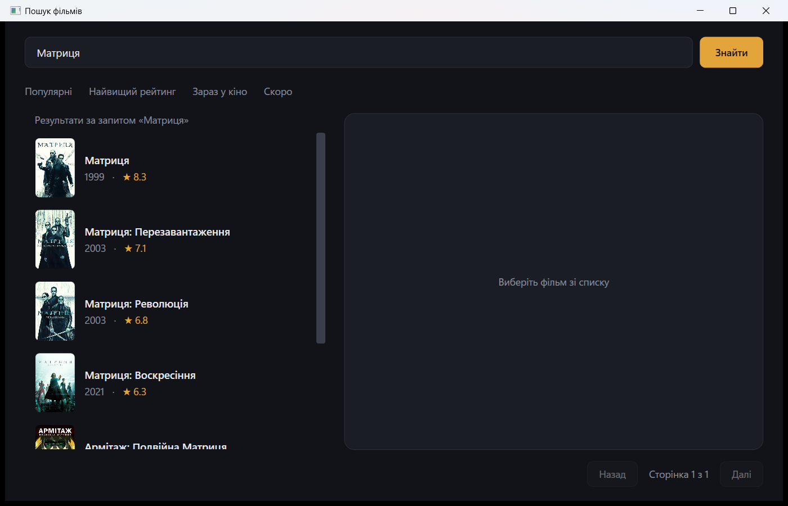

# 01. Пошук фільмів (WPF + TMDB)

Віконний застосунок на WPF (.NET 8): пошук фільмів за назвою, перегляд рейтингу та каталогів
(популярні, найвищий рейтинг, зараз у кіно, скоро в кіно). Дані й постери беруться з безкоштовного
API [The Movie Database](https://developer.themoviedb.org/docs/getting-started).

## Як запустити

1. Потрібен [.NET 8 SDK](https://dotnet.microsoft.com/download/dotnet/8.0) і Windows.
2. Отримайте ключ на https://www.themoviedb.org/settings/api (безкоштовно, для навчання).
3. Вкажіть ключ одним зі способів (у git він не потрапляє):
   - скопіюйте `appsettings.local.example.json` у `appsettings.local.json` і впишіть ключ, **або**
   - задайте змінну середовища `TMDB_API_KEY`.
   Підійде і короткий «API Key» (v3), і довгий «API Read Access Token» (v4).
4. Запуск:

```bash
dotnet run
```

Без ключа застосунок відкриється, але покаже підказку, що ключ не вказано.

## Структура

- `Models/Movie.cs` — модель фільму та відповіді API (JSON → C#).
- `Services/TmdbService.cs` — усі HTTP-запити до TMDB і читання ключа.
- `MainWindow.xaml` — розмітка: пошук, список з постерами, панель деталей, сторінки.
- `MainWindow.xaml.cs` — логіка вікна: пошук, вибір каталогу, пагінація, показ деталей.

## Як виглядає




Вкладки зверху перемикають каталоги, поле пошуку шукає за назвою, кнопки «Назад/Далі» гортають сторінки.
У правій панелі показано постер, рік, рейтинг і опис вибраного фільму.
