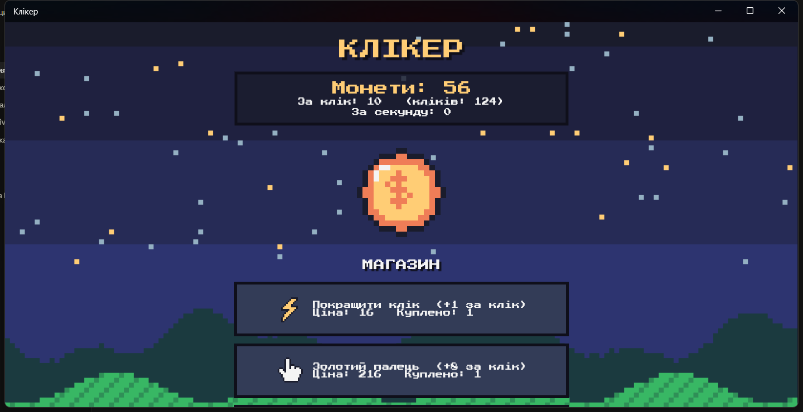

# 02. Кліkер на .NET MAUI

Гра-клікер у піксельному стилі: клікаємо по монеті, купуємо покращення в магазині, гру можна зберегти у файл і завантажити.



## Що зроблено (за завданням з 10.09)

- Базовий клікер з заняття (код від викладача) перероблено на **магазин з шістьма товарами**: два покращення кліка («Покращити клік», «Золотий палець») і чотири джерела пасивного доходу («Автоклікер», «Ферма», «Фабрика», «Шахта»). Ціна кожного товару росте з кожною покупкою.
- **Збереження і завантаження гри у файл** (`clicker-save.json`, формат JSON). Збереження підхоплюється автоматично при запуску.
- **Картинки на кнопках**: монета (`ImageButton`) та іконки товарів і кнопок збереження (`Button.ImageSource`).
- Піксельне оформлення: усі спрайти намальовані скриптом `tools/GenerateSprites.ps1`, чужих файлів немає.

## Як запустити

Потрібні Windows, [.NET 8 SDK](https://dotnet.microsoft.com/download/dotnet/8.0) і навантаження MAUI:

```bash
dotnet workload install maui-windows maui-android
dotnet run -f net8.0-windows10.0.19041.0
```

Для запуску на Windows також потрібен Windows App Runtime 1.5 (зазвичай уже встановлений). Файл збереження лежить у папці даних застосунку (`FileSystem.AppDataDirectory`).

## Структура

- `MainPage.xaml` — розмітка: фон, табло, монета, список товарів, кнопки збереження.
- `MainPage.xaml.cs` — логіка гри: клік, покупка, таймер автоклікер, збереження/завантаження.
- `Models/ShopItem.cs` — один товар магазину (назва, іконка, ціна, бонус).
- `Models/SaveData.cs` — дані, що записуються у файл.
- `Resources/Images/` — піксельні спрайти (PNG). `tools/GenerateSprites.ps1` — генератор цих спрайтів.

## Як це працює (коротко)

1. **Товари як дані.** Усі товари описані одним списком у `CreateShop()`. XAML містить один шаблон кнопки (`BindableLayout`), тому новий товар додається одним рядком.
2. **Сила кліка й дохід на секунду** не зберігаються окремо: вони обчислюються як сума бонусів від куплених товарів. Через це у файл треба писати лише кількість покупок.
3. **Автоклікер** — це `IDispatcherTimer` з інтервалом 1 с, який додає `PerSecond` монет.
4. **Збереження** — клас `SaveData` серіалізується в JSON через `System.Text.Json`. Товари зберігаються за `Id`, тому нові товари не ламають старі файли.
