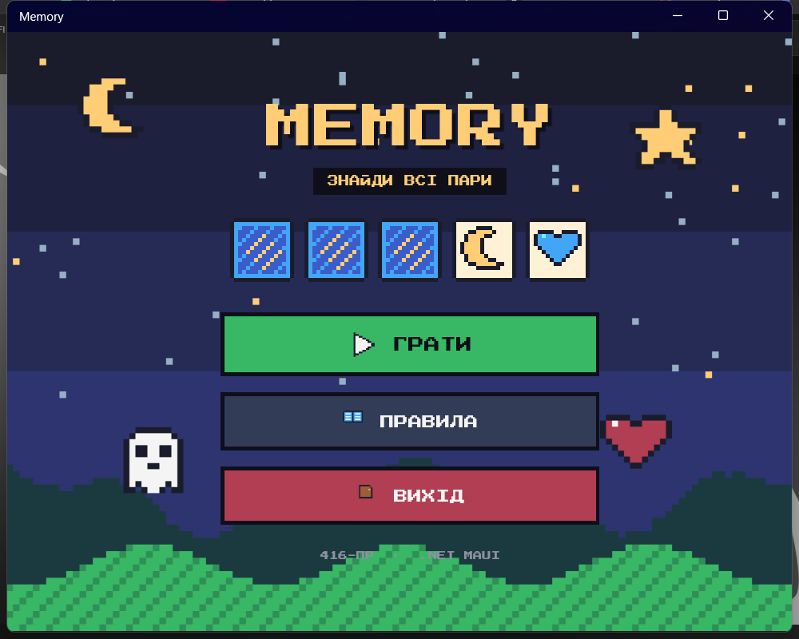
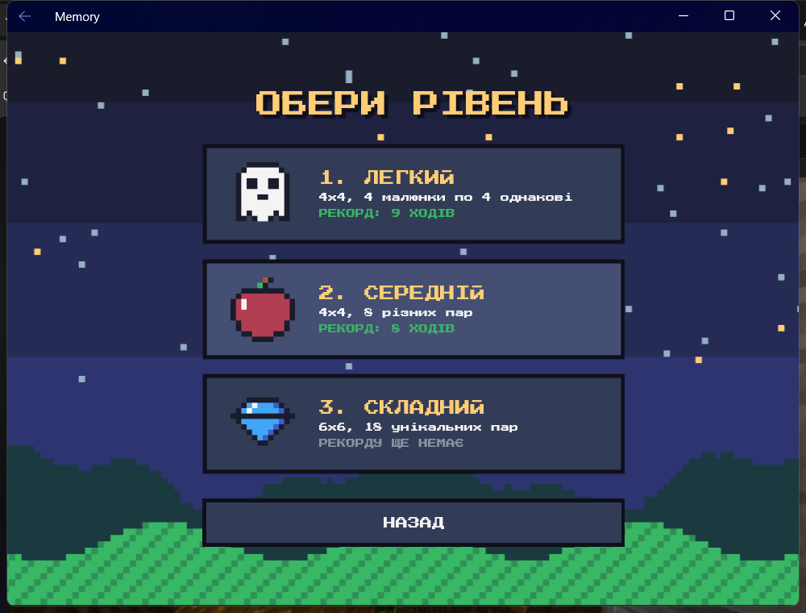
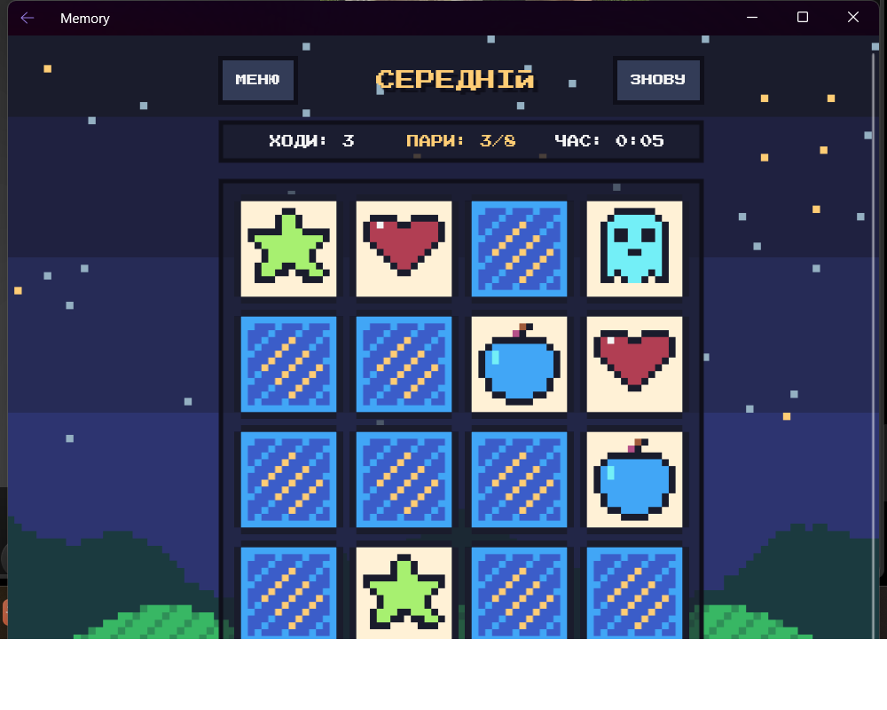
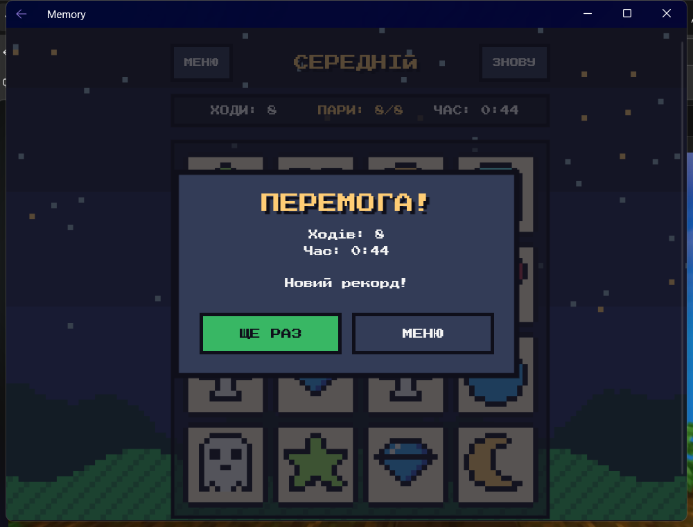

# 03. Memory на .NET MAUI

Гра «Memory» у піксельному стилі: меню → вибір рівня → гра. Три рівні складності, секундомір, лічильник ходів і збережені рекорди.






## Що зроблено (за завданням з 17.09)

- **Гра на одному екрані**: поле 4×4, картки перевертаються, однакові залишаються відкритими, різні закриваються.
- **Рівні складності** (`Models/LevelConfig.cs`):
  1. Легкий: 4×4, 4 малюнки по 4 однакові.
  2. Середній: 4×4, 8 різних пар.
  3. Складний: 6×6, 18 унікальних пар.
- **Другий екран і навігація**: три сторінки (`MenuPage` → `LevelPage` → `GamePage`) зареєстровані в `AppShell.xaml.cs` через `Routing.RegisterRoute`. Є кнопки переходу вперед і повернення назад.
- **Стартове меню**: «Грати», «Правила», «Вихід».
- Додатково: рекорд (найменша кількість ходів) для кожного рівня зберігається через `Preferences`.
- Оформлення: усі картки та іконки намальовані скриптом `tools/GenerateSprites.ps1`, шрифт [Press Start 2P](https://fonts.google.com/specimen/Press+Start+2P) (SIL OFL, `licenses/`), власне діалогове вікно `Controls/PixelDialog`.

## Як запустити

Потрібні Windows, [.NET 8 SDK](https://dotnet.microsoft.com/download/dotnet/8.0) і навантаження MAUI:

```bash
dotnet workload install maui-windows maui-android
dotnet run -f net8.0-windows10.0.19041.0
```

## Структура

- `AppShell.xaml(.cs)` — каркас, стартова сторінка і реєстрація маршрутів.
- `Pages/MenuPage` — меню з анімаціями (гойдання малюнків, картки, що самі перевертаються).
- `Pages/LevelPage` — вибір рівня, картки рівнів будуються за списком `LevelConfig.All`.
- `Pages/GamePage` — вся логіка гри.
- `Controls/PixelDialog` — діалог у стилі гри (правила, перемога).
- `Resources/Styles/Pixel.xaml` — спільні кольори і стилі (кнопки, заголовки, шрифт).

## Як це працює (коротко)

1. **Дані замість копіпасти.** Рівень — це запис `LevelConfig` (стовпці, рядки, кількість малюнків, копій). Гра бере ці числа, будує колоду, перемішує її (`Random.Shared.Shuffle`) і створює сітку карток у коді. Новий рівень додається одним рядком.
2. **Навігація.** `Routing.RegisterRoute(nameof(GamePage), typeof(GamePage))` дозволяє перейти за назвою: `Shell.Current.GoToAsync("GamePage?level=2")`. Номер рівня потрапляє в `GamePage` через `[QueryProperty]`. Повернення на крок назад — `GoToAsync("..")`, у меню — `GoToAsync("//MenuPage")`.
3. **Логіка пари.** Перша відкрита картка запам'ятовується в `_first`. Друга порівнюється з нею за малюнком: збіг — обидві стають `IsMatched`, ні — через 0,7 с закриваються. Поки йде анімація, прапорець `_busy` ігнорує нові кліки.
4. **Перевертання картки** — це анімація: `ScaleXTo(0)` → зміна картинки → `ScaleXTo(1)`.
5. **Рекорди** зберігаються в `Preferences` за ключем рівня, тому переживають перезапуск гри.
