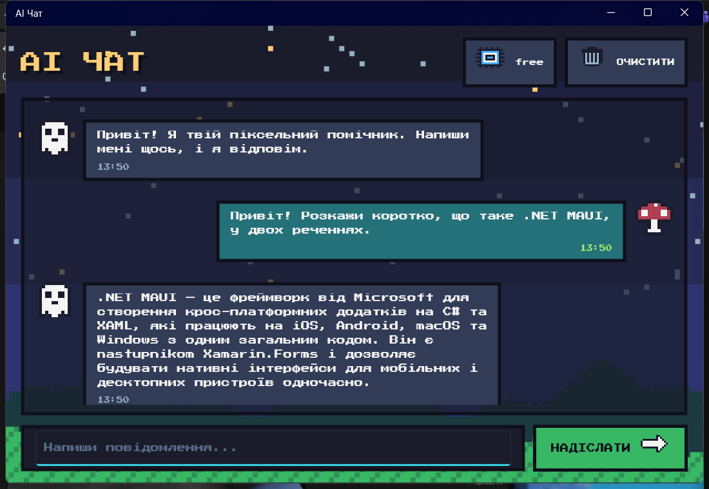
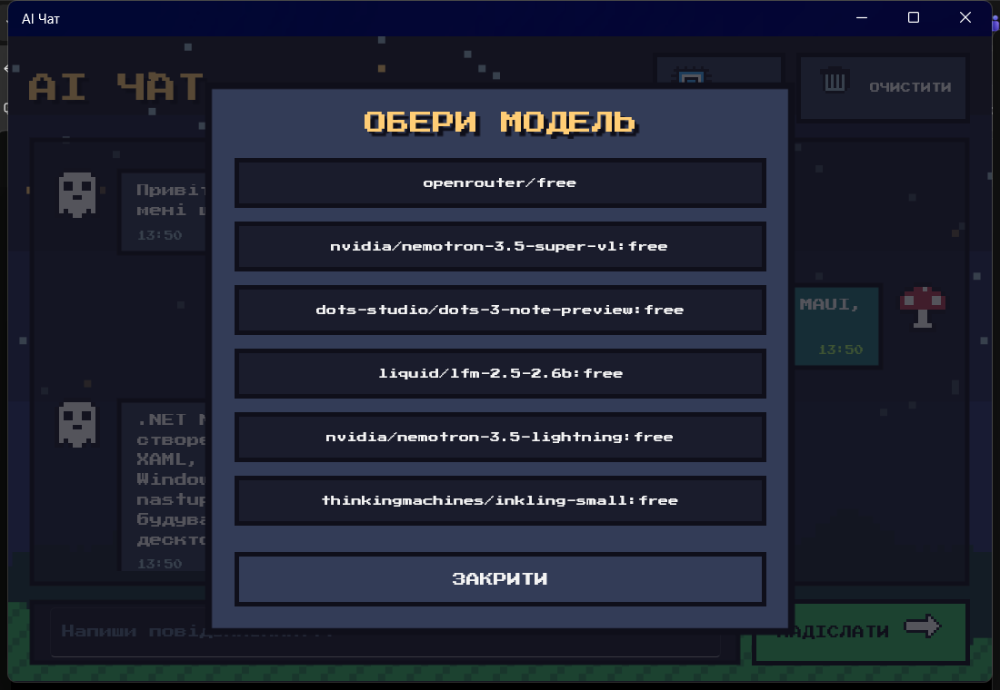

# 04. Чат з ШІ на .NET MAUI (OpenRouter)

Вікно для спілкування зі штучним інтелектом у піксельному стилі. Запити йдуть до [OpenRouter](https://openrouter.ai) (безкоштовні моделі) через офіційну бібліотеку **OpenAI** з NuGet.




## Що зроблено (за завданням з 24.09)

- Інтерфейс чату: список повідомлень з «бульбашками» (користувач справа, ШІ зліва), поле вводу, кнопка «Надіслати» (також Enter).
- Інтеграція з OpenRouter через пакет `OpenAI` (змінено лише адресу сервера).
- ШІ пам'ятає розмову: щоразу надсилається вся історія.
- **Вибір моделі** (додаткове завдання): список безкоштовних моделей підтягується з OpenRouter, обрана модель діє одразу.
- Індикатор «ШІ думає», кнопка очищення розмови, зрозумілі повідомлення про помилки (неправильний ключ, перевантажена модель, немає інтернету).

## Як запустити

1. Потрібні Windows, [.NET 8 SDK](https://dotnet.microsoft.com/download/dotnet/8.0) і навантаження MAUI:

```bash
dotnet workload install maui-windows maui-android
```

2. Отримайте безкоштовний ключ на https://openrouter.ai/keys. Далі **один із двох способів**:
   - скопіюйте `secrets.local.example.json` у `secrets.local.json` і впишіть ключ (файл у `.gitignore`, у git не потрапляє; він вшивається в застосунок під час збирання), **або**
   - запустіть застосунок без файлу: він сам попросить вставити ключ і збереже його на пристрої.

3. Запуск:

```bash
dotnet run -f net8.0-windows10.0.19041.0
```

## Структура

- `Pages/ChatPage` — екран чату і вся його логіка (надсилання, індикатор, вибір моделі, ключ).
- `Services/AiService.cs` — уся робота з ШІ: читання ключа, запит до моделі, список безкоштовних моделей.
- `Models/ChatLine.cs` — одне повідомлення; `Models/ChatTemplateSelector.cs` — вибір вигляду «бульбашки».
- `Resources/Styles/Pixel.xaml` — спільні кольори і стилі. `tools/GenerateSprites.ps1` — генератор картинок.

## Як це працює (коротко)

1. **Клієнт OpenAI для OpenRouter.** OpenRouter повторює формат API OpenAI, тому `new ChatClient(модель, ключ, new OpenAIClientOptions { Endpoint = ".../api/v1" })` працює без змін. Модель `openrouter/free` сама підбирає вільну безкоштовну модель.
2. **Історія.** Список `ObservableCollection<ChatLine>` одночасно є джерелом для екрана і історією для моделі: кожне повідомлення перетворюється на `UserChatMessage` або `AssistantChatMessage`.
3. **Не блокуємо екран.** Запит виконується через `await`, поки анімується «ШІ думає», а кнопка вимкнена, щоб не надіслати друге повідомлення раніше часу.
4. **Різні шаблони повідомлень.** `DataTemplateSelector` вибирає шаблон за автором: це дає різне вирівнювання і колір.
5. **Ключ не в git.** Ключ береться з `secrets.local.json` (у `.gitignore`) або з налаштувань пристрою, у коді його немає.
