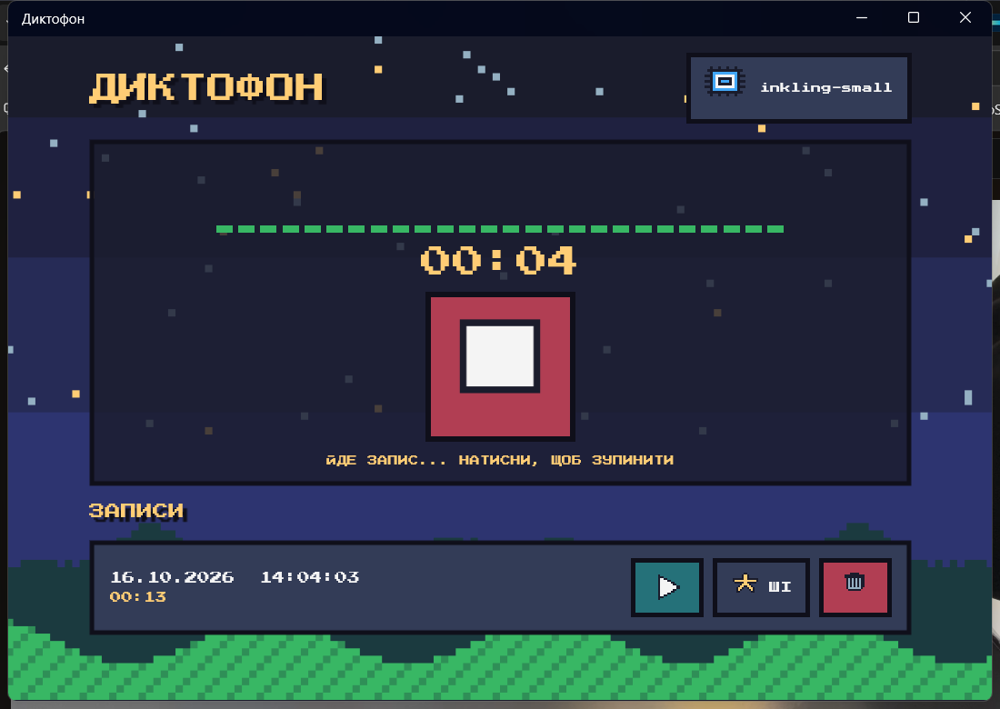
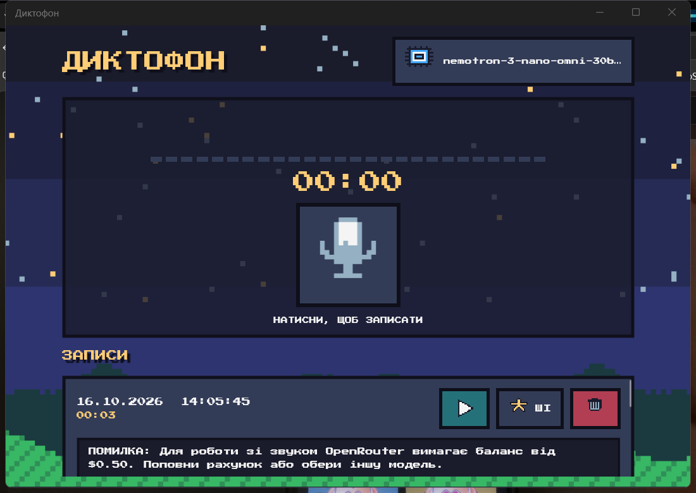

# 05. Диктофон на .NET MAUI + відправка запису в ШІ

Диктофон у піксельному стилі: запис з мікрофона, список записів, відтворення, видалення і відправка запису в ШІ (OpenRouter).




## Що зроблено (за завданням з 01.10)

**Частина 1: запис з мікрофона**
- Кнопки «почати / зупинити запис» об'єднані в одну велику кнопку. Під час запису йде таймер і «еквалайзер», що реагує на гучність.
- **Android**: `MediaRecorder` з коду викладача, формат `.m4a`. Дозвіл на мікрофон запитується через `Permissions.RequestAsync<Permissions.Microphone>()`, у `AndroidManifest.xml` додано `RECORD_AUDIO`.
- **Windows**: бібліотека NAudio (`WaveInEvent`), формат `.wav` (16 кГц, моно). У `Package.appxmanifest` додано `DeviceCapability microphone`.
- Записи зберігаються у папці даних застосунку, список підхоплюється при запуску.

**Частина 2: відправка запису в ШІ**
- Модуль з ШІ перенесено з попереднього завдання (чат): той самий ключ OpenRouter, вибір моделі, повідомлення про помилки.
- Файл кодується в base64 і надсилається в повідомленні як `input_audio`. Модель має сама розпізнати мову і зробити конспект. У списку моделей залишаються лише безкоштовні, які приймають звук.

**Відомі обмеження** (як і говорив викладач 15.10, робота зараховується «як є»)
- Мікрофон перевірено лише на Windows. На Android код написано за зразком викладача, але на пристрої не запускався.
- Безкоштовні моделі OpenRouter зі звуком зараз або закриті для звичайних застосунків (помилка 403), або вимагають баланс від $0.50 (помилка 402). У цих випадках застосунок показує зрозуміле повідомлення. З поповненим рахунком відправка працює (формат запиту перевірено: сервер його приймає).

## Як запустити

```bash
dotnet workload install maui-windows maui-android
dotnet run -f net8.0-windows10.0.19041.0
```

Ключ OpenRouter: скопіюйте `secrets.local.example.json` у `secrets.local.json` і впишіть ключ (файл у `.gitignore`), або вставте його у вікні, яке застосунок покаже сам.

## Структура

- `Pages/RecorderPage` — екран: запис, еквалайзер, список, вибір моделі, ключ.
- `Services/AudioRecorder.cs` — запис і відтворення: одна реалізація для Android, інша для Windows (`#if ANDROID` / `#elif WINDOWS`).
- `Services/AiService.cs` — відправка звуку в ШІ та список моделей.
- `Models/Recording.cs` — один запис (з автооновленням екрана).

## Як це працює (коротко)

1. **Мікрофон залежить від платформи**, тому код розділено директивами `#if`. Решта програми користується однаковими методами `StartAsync`, `StopAsync`, `Play`.
2. **Дозвіл** користувач дає один раз; без нього система не віддасть мікрофон.
3. **Еквалайзер**: з кожної порції звуку беремо найгучніший відлік, нормалізуємо до 0..1 і зсуваємо історію рівнів вліво, а таймер щоразу перемальовує стовпчики.
4. **Запит у ШІ**: аудіо в base64 + текстове завдання в одному повідомленні, відповідь показується під записом.
