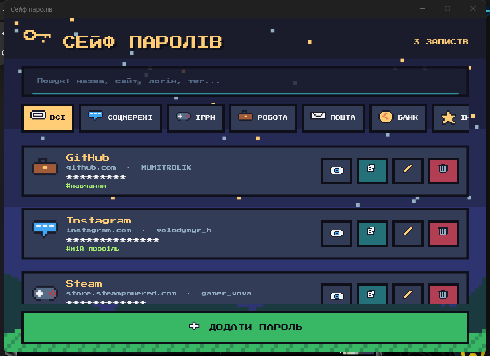
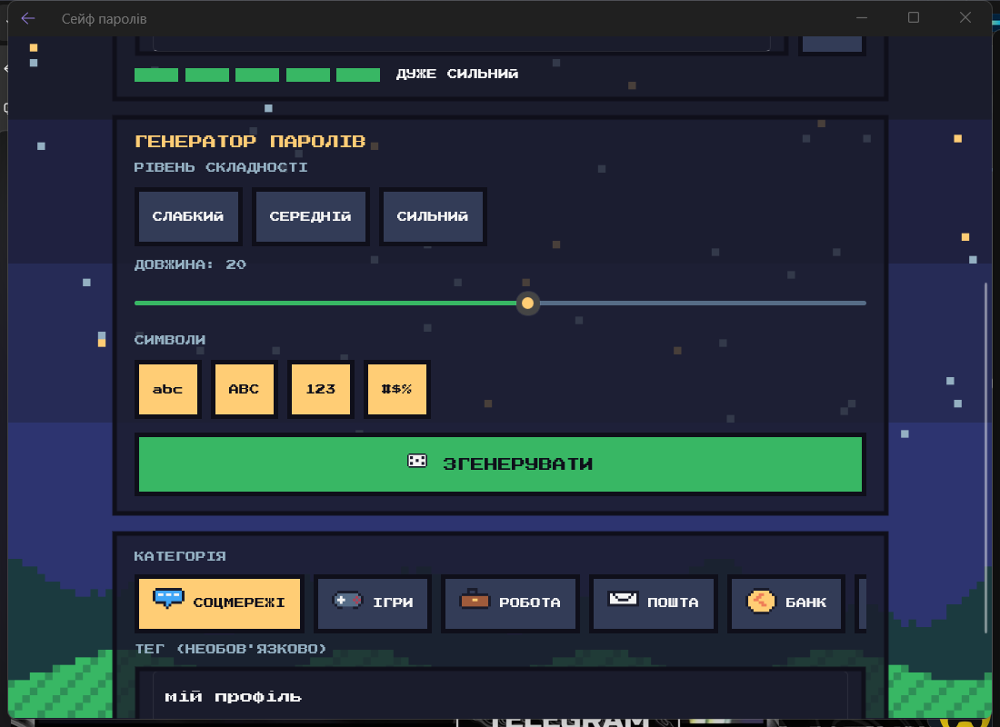

# 06. Менеджер паролів на .NET MAUI

Сховище паролів у піксельному стилі: назва, сайт, логін, пароль (закритий зірочками), категорії й теги, генератор паролів.




## Що зроблено (за завданням з 08.10)

**Основна частина**
- Додавання запису: назва, сайт, логін і пароль. У списку пароль показується **зірочками**, кнопка-«око» відкриває його, а кнопка копіювання кладе пароль у буфер обміну (через 30 секунд буфер очищається).
- Редагування і видалення (з підтвердженням).
- Дані зберігаються у файлі `vault.json` у приватній папці застосунку. **Паролі там зашифровані** (AES-256-GCM), відкритого пароля на диску немає.

**Покращення**
- **Категорії**: соцмережі, ігри, робота, пошта, банк, інше. Список можна фільтрувати кнопками-категоріями.
- **Теги**: до запису можна додати власний тег (наприклад, назву компанії), він показується в списку.
- Пошук за назвою, сайтом, логіном і тегом.

**Додаткове завдання: генератор паролів**
- Три рівні складності (слабкий, середній, сильний), повзунок довжини від 6 до 32, вибір наборів символів (`abc`, `ABC`, `123`, `#$%`).
- Індикатор стійкості з п'яти сегментів: оцінка за ентропією пароля.
- Генератор використовує криптографічний `RandomNumberGenerator`, схожі символи (0/O, 1/l/I) виключено.

## Як запустити

```bash
dotnet workload install maui-windows maui-android
dotnet run -f net8.0-windows10.0.19041.0
```

## Структура

- `Pages/VaultPage` — список, пошук, фільтр за категорією.
- `Pages/EntryPage` — додавання і редагування запису, генератор.
- `Services/VaultStore.cs` — читання і запис файлу. `Services/SecretProtector.cs` — шифрування.
- `Services/PasswordGenerator.cs` — генерація і оцінка стійкості.
- `Models/` — `VaultEntry` (запис у файлі), `EntryItem` (запис для екрана), `Category`.

## Як це працює (коротко)

1. **Шифрування.** Перед записом пароль шифрується AES-GCM. Ключ випадковий (32 байти), створюється один раз і зберігається в `SecureStorage` пристрою, тобто окремо від файлу. У файлі лежить `nonce + тег + шифротекст` у base64. Якщо `SecureStorage` недоступний, використовується файл ключа в приватній папці.
2. **Зірочки.** `EntryItem.PasswordShown` повертає рядок із зірочок, поки `IsRevealed` дорівнює false. Кнопка-око перемикає прапорець, а `INotifyPropertyChanged` оновлює екран.
3. **Генератор.** Беремо по одному символу з кожного обраного набору (щоб вони точно були в паролі), доповнюємо випадковими до потрібної довжини і перемішуємо алгоритмом Фішера-Єйтса.
4. **Стійкість.** `ентропія = довжина × log2(розмір алфавіту)`. Менше 28 біт: дуже слабкий, понад 90 біт: дуже сильний.
5. **Навігація.** Екран запису відкривається через `Shell.GoToAsync("EntryPage?id=...")`, id попадає в сторінку через `[QueryProperty]`.
