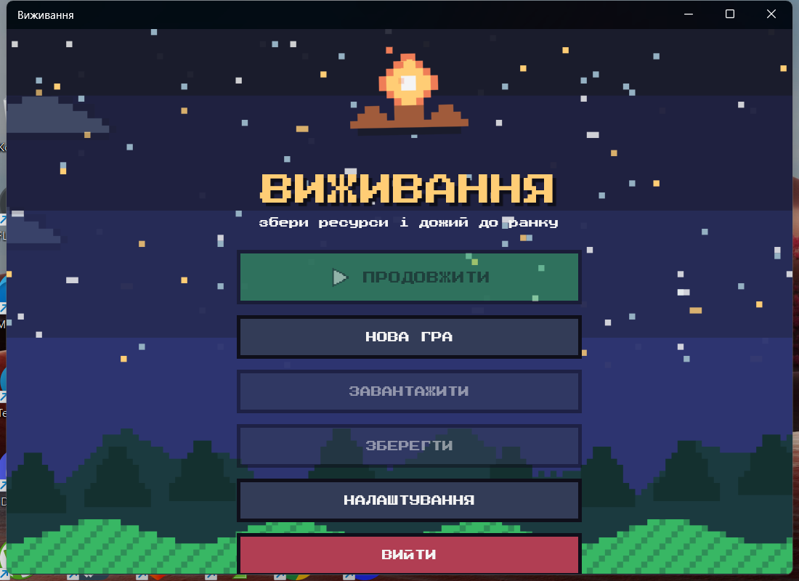
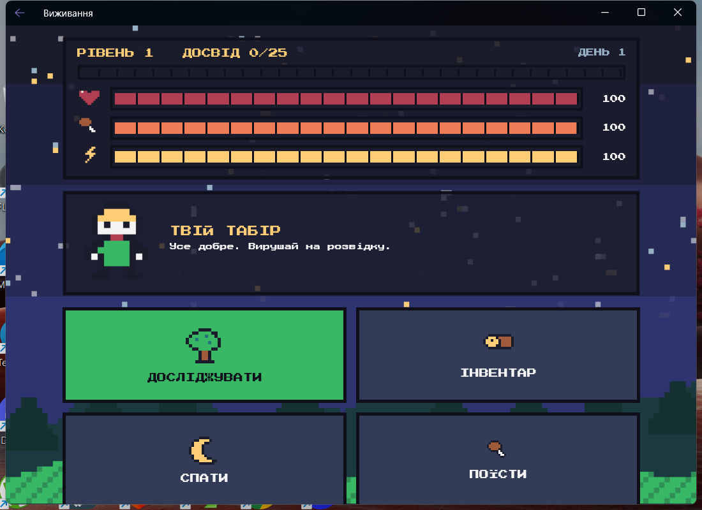
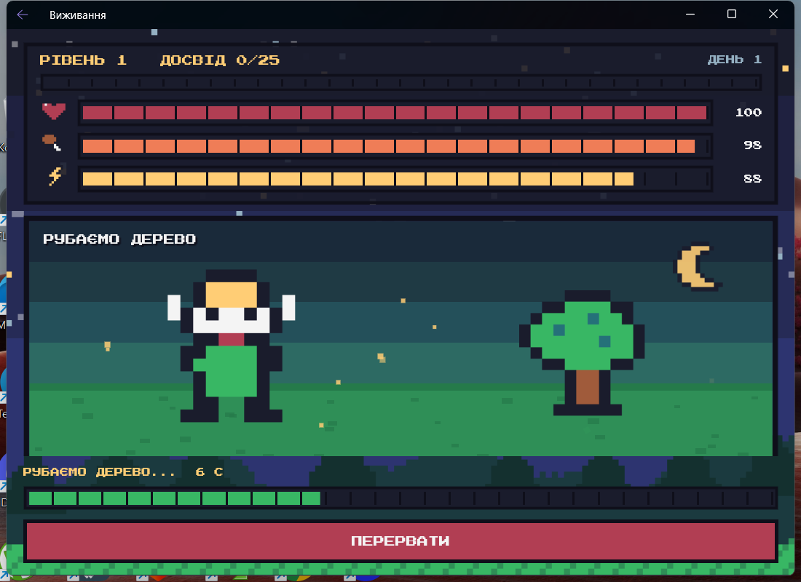
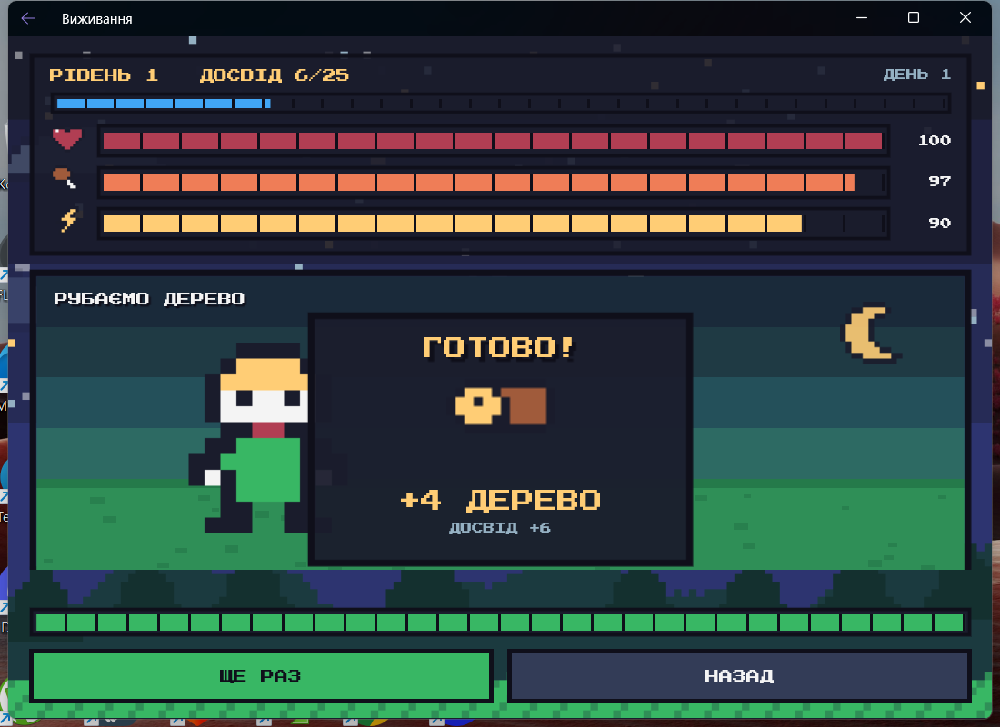
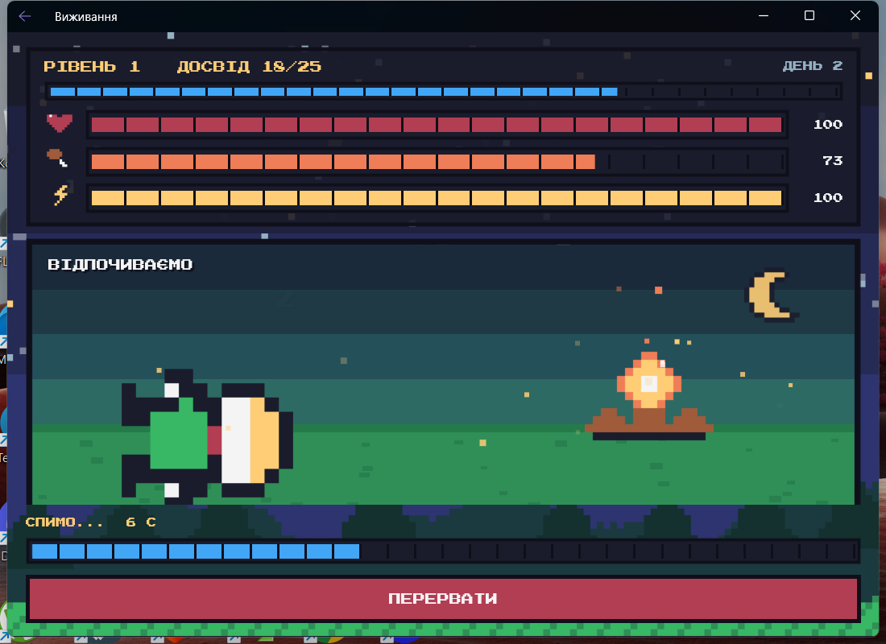
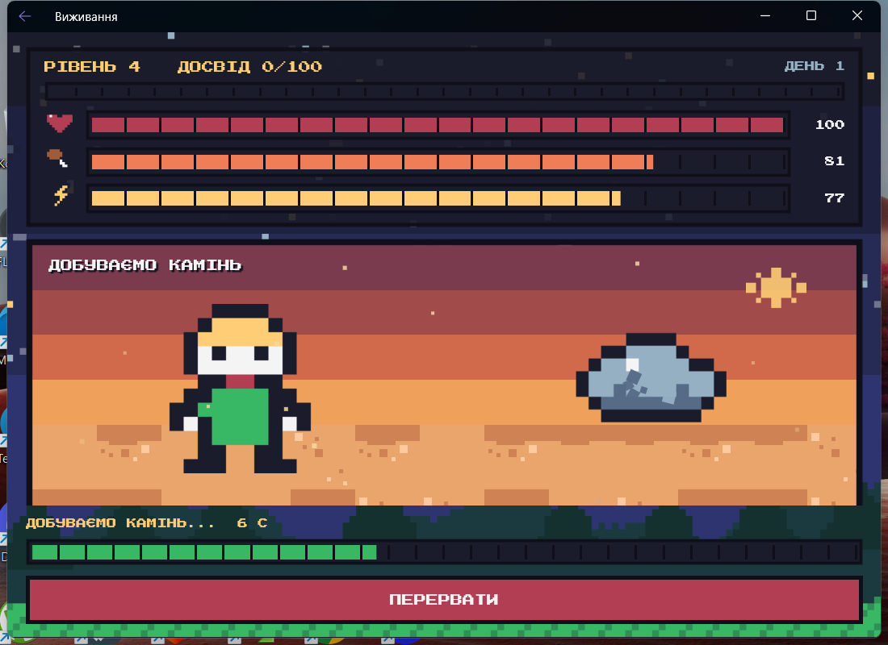
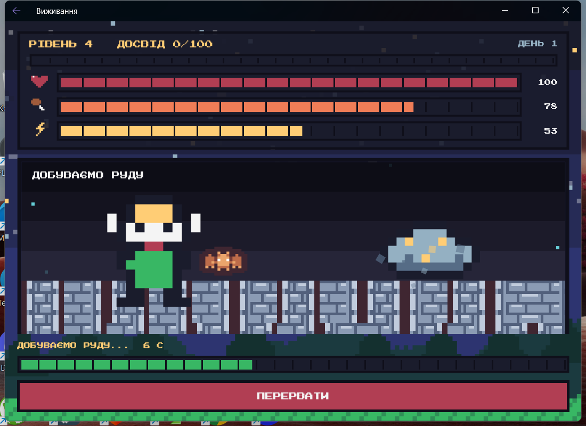
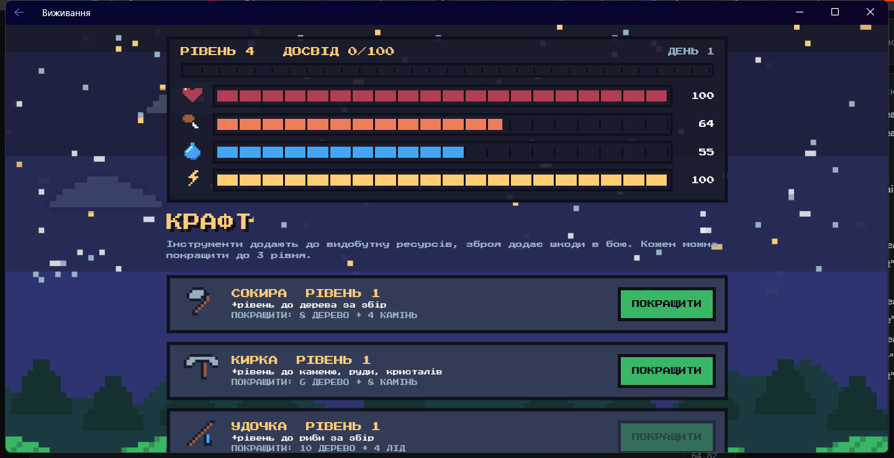
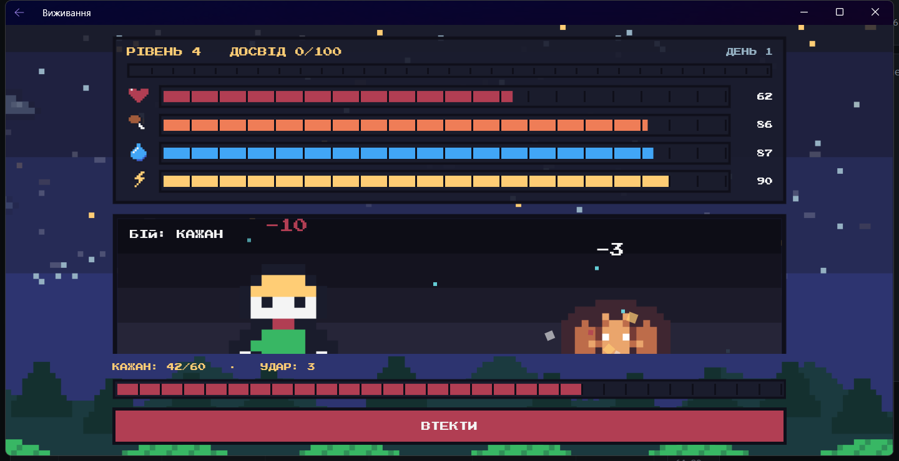
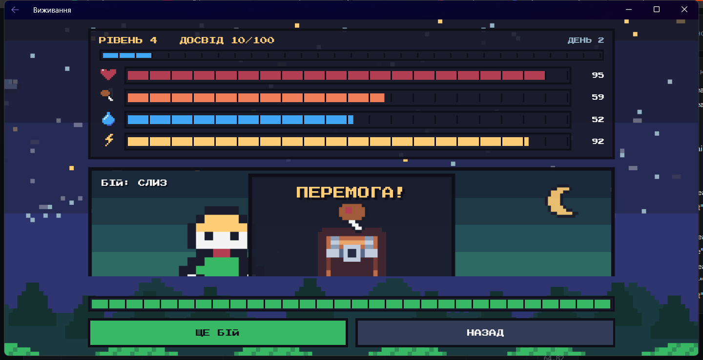

# 07. Гра на виживання (.NET MAUI)

Піксельна міні-гра на виживання: здоров'я, голод, спрага й енергія, рівні та навички, локації зі збором ресурсів, крафт і прокачування інструментів, бойова система з ворогами та зброєю, автозбереження прогресу і окремі анімовані сцени дій.












## Що зроблено

**Система виживання** (завдання з MyStat: здоров'я, голод, спрага, енергія)
- Чотири показники. Голод і спрага падають із часом (уві сні повільніше), енергія йде на дії і відновлюється сном.
- Якщо голод або спрага дійшли до нуля, здоров'я зменшується. Коли все гаразд, воно повільно відновлюється.
- Їжа (ягоди, гриби, риба, м'ясо) втамовує голод, питво (вода, лід, кактус) втамовує спрагу. Воду можна набирати в лісі.
- Якщо здоров'я скінчилось, герой непритомніє: втрачає половину ресурсів і прокидається ослабленим.

**Екрани** (між усіма є переходи вперед і назад)
- **Головне меню**: продовжити, нова гра, завантажити, зберегти, налаштування, вийти.
- **Табір**: смуги стану, рівень, досвід, день, інструменти з рівнями; дії «Досліджувати», «Інвентар», «Прокачка», «Спати», «Поїсти», «Попити».
- **Дослідження локацій**: ліс, пустеля, тундра, печера. Кожна відкривається з певного рівня героя.
- **Локація**: список дій збору ресурсів і картка бою з місцевим ворогом.
- **Інвентар**: ресурси з кнопками «З'їсти» і «Випити».
- **Прокачка**: крафт і покращення інструментів та зброї, навички героя.
- **Налаштування**: повзунки музики і звуків (заглушки), перемикач підказок.

**Фарм ресурсів за часом**
- Кнопка запускає збір на **10 секунд**, під час якого герой зайнятий. Є змінні: енергія, досвід, випадкова кількість ресурсу.

**Крафтинг і прокачування**
- Сокира, кирка, вудка дають бонус до видобутку, спис і меч дають шкоду в бою.
- Кожен предмет має до **3 рівнів**. Створення і покращення коштують ресурсів, вартість росте разом із рівнем. Бонус до видобутку дорівнює рівню інструмента.
- Кожен новий рівень героя дає **очко навичок**: «Сила» (+2 до удару за очко) або «Витривалість» (−5% витрат енергії за очко).

**Бойова система**
- У кожній локації живе свій ворог (слиз, павук, привид, кажан) із власним здоров'ям, шкодою, досвідом і здобиччю.
- Бій іде сам по тактах: герой б'є раз на 0,9 с, ворог раз на 1,3 с. Шкода має розкид ±20% і 15% шансу на критичний удар (подвійна шкода). Шкода героя = кулаки (3) + найкраща зброя + сила.
- З бою можна втекти. Перемога дає досвід і здобич (у сундуку), поразка забирає половину ресурсів.

**Збереження прогресу**
- Автоматичне локальне збереження в JSON: кожні 15 секунд, після кожного збору, бою, створення чи покращення предмета й вкладання навичок. У панелі стану на мить спалахує напис «ЗБЕРЕЖЕНО». Збереження зі старої версії (без спраги і рівнів) також читається.

**Окрема сцена дії** (власна ідея, щоб було цікавіше)
- Збір відкриває сцену: герой замахується інструментом, ціль трясеться, летять уламки, дерево падає, потім із сундука вилітає нагорода. Такі самі сцени є для бою (числа шкоди, спалахи, удари вперед) і для сну біля вогнища.

## Як запустити

```bash
dotnet workload install maui-windows maui-android
dotnet run -f net8.0-windows10.0.19041.0
```

## Структура

- `Services/GameState.cs` — вся логіка: характеристики, час, збір, їжа й питво, крафт, навички, бій, автозбереження.
- `Models/Catalog.cs` — дані гри: ресурси, локації, дії, вороги, інструменти й зброя (щоб додати нову локацію чи ворога, достатньо дописати рядок).
- `Models/SaveData.cs` — що саме записується у файл збереження.
- `Pages/` — екрани (`MenuPage`, `HomePage`, `LocationsPage`, `LocationPage`, `ScenePage`, `InventoryPage`, `UpgradePage`, `SettingsPage`).
- `Controls/` — `HudBar` (панель стану), `PixelBar` (смуга), `Backdrop` (живий фон), `PixelDialog`.
- `Services/Fx.cs` — спільні анімації. `tools/GenerateSprites.ps1` — генератор власних картинок.

## Як це працює (коротко)

1. **Один спільний стан.** `GameState.Current` живе весь час роботи застосунку, тому прогрес не губиться під час переходів між екранами. Екрани підписуються на подію `Changed` і самі перемальовуються.
2. **Ігровий час.** Таймер раз на 100 мс викликає `Tick(dt)`. `dt` рахується за справжнім годинником (`Stopwatch`), тому 10 секунд збору завжди дорівнюють 10 справжнім секундам, навіть якщо кадр затримався.
3. **Збір ресурсів.** `StartTask` одразу списує енергію і створює `ActiveTask`. У кожному тіку `Remaining` зменшується, а в кінці `FinishTask` додає випадкову кількість ресурсу (плюс рівень інструмента), досвід і запам'ятовує підсумок для екрана нагороди.
4. **Бій.** `StartFight` створює `ActiveFight` із таймерами ударів. Кожен тік `FightStep` віднімає таймери, коли вони дійшли до нуля, наносить удар і повідомляє екран подією `FightHit` (хто вдарив, скільки, чи критичний), а екран показує анімацію.
5. **Дані замість копіпасти.** Локації, дії, вороги й інструменти описані в `Catalog`, екрани будуються з нього в циклі.
6. **Навігація.** Екрани зареєстровані в `AppShell.xaml.cs` через `Routing.RegisterRoute`; параметри (`place`, `action`, `mode`) передаються в рядку маршруту і потрапляють у сторінку через `[QueryProperty]`.
7. **Анімації.** Смуги плавно «доганяють» значення таймером ~60 разів на секунду. Уламки летять по параболі (формула у `Animation`). Зірки і хмаринки фону на Windows віддані композитору WinUI (відеопідсистемі), тому не навантажують процесор.
8. **Збереження.** `SaveData` серіалізується в JSON (`survival-save.json`) у приватній папці застосунку; `AutoSave` викликається з тіку, а також після важливих подій.

## Ресурси і ліцензії

- Частину спрайтів (сундук, чарівник, слиз, павук, привид, кажан, плитки підлоги) узято з пакета **Tiny Dungeon** від [Kenney](https://kenney.nl/assets/tiny-dungeon), ліцензія **CC0** (текст у `licenses/Kenney-TinyDungeon-CC0.txt`). Решта малюнків намальована скриптом `tools/GenerateSprites.ps1`.
- Шрифт [Press Start 2P](https://fonts.google.com/specimen/Press+Start+2P), ліцензія SIL OFL (`licenses/PressStart2P-OFL.txt`).
